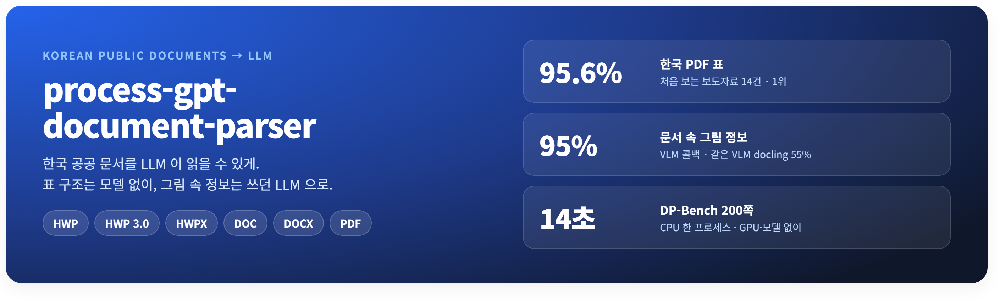
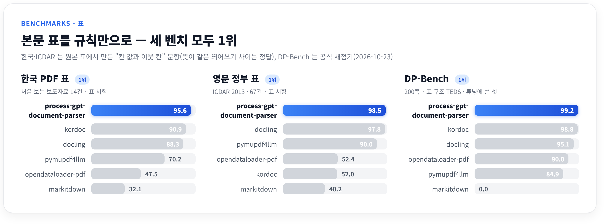
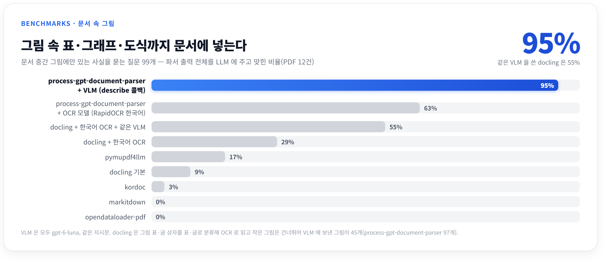
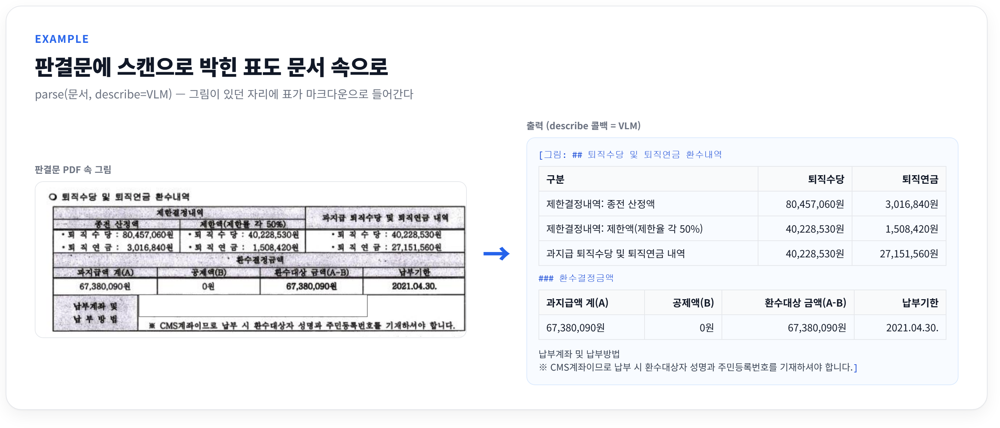
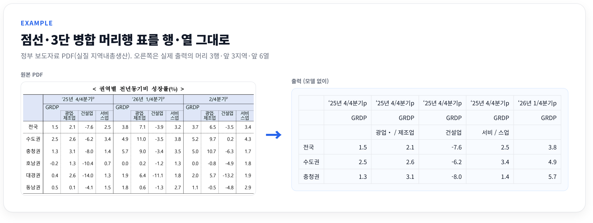

<p align="center">
  
</p>

<p align="center">
  
  
  
  
</p>

---

## 특징

- **한국 공공 문서 포맷을 모두** — HWP 5.0·**HWP 3.0(한글 97)**·배포용 HWP, HWPX, DOC, DOCX, PDF. 비교한 오픈소스 중 전부 읽는 것은 이것뿐이다.
- **PDF 표 1위** — 처음 보는 정부 보도자료 14건 표 시험 **95.6%**(kordoc 90.9%, docling 88.3%), 영문 정부 표 ICDAR
  **98.5%**(docling 97.8%), DP-Bench 표 구조 TEDS **99.2**(kordoc 98.8).
- **문서 속 그림까지** — 그림 설명 콜백에 쓰던 LLM(VLM)을 꽂으면 그림 표·그래프·도식의 정보가 문서에 들어간다.
  그림 벤치에서 LLM 이 문서를 읽고 맞힌 질문 **95%**(PDF 99문항 중 94). 같은 모델을 쓴 docling 은 55%.
- **모델 없이, GPU 없이** — 본문·표는 규칙만으로 읽는다. DP-Bench 200쪽을 한 프로세스로 14초(쪽당 0.07초, CPU). 그래프가 많은 보고서도 선은 PDFium 으로 읽어 빠르다.
- **폐쇄망 그대로** — 모델은 라이브러리에 없고 함수로 넘긴다. OCR 모델이 없어도 사내 VLM 하나를 그림 콜백에 꽂으면 된다.
- **자체 구현, 깨끗한 라이선스** — HWP·DOC 은 공개 명세로 직접 구현. 한컴·LibreOffice 불필요, AGPL·GPL 의존성 없음.

## 성능

### 표 (본문 글 레이어)



<details>
<summary>전체 표</summary>

| 파서 | 한국 PDF 표<br>튜닝용 37건 | 한국 PDF 표<br>real4 15건 | 한국 PDF 표<br>처음 보는 14건 | 영문 정부 표<br>ICDAR 67건 | DP-Bench<br>표 F1 / TEDS / NID | 한국 HWP 표<br>18건 |
|---|---:|---:|---:|---:|---:|---:|
| **process-gpt-document-parser** | **98.3%** | **96.6%** | **95.6%** | **98.5%** | **97.2** / **99.2** / **96.1** | **97.0%** |
| ↳ + 그림 VLM 콜백 | | | | | **99.1** / 99.1 / **96.1** | |
| kordoc | 87.4% | 95.6% | 90.9% | 52.0% | **97.2** / 98.8 / **96.1**¹ | — |
| docling | 88.8% | 75.1% | 88.3% | 97.8% | 91.5 / 95.1 / 86.9 | 미지원 |
| pymupdf4llm | 86.4% | 79.3% | 70.2% | 90.0% | 87.0 / 84.9 / 89.6 | 미지원 |
| opendataloader-pdf | 14.6% | 11.9% | 47.5% | 52.4% | 43.3 / 90.0 / 93.7 | 미지원 |
| markitdown | 38.2% | 26.3% | 32.1% | 40.2% | 0.0 / 0.0 / 81.6 | 미지원 |

¹ kordoc 은 200쪽 중 11쪽을 읽지 못해 NID 가 189쪽 평균이다. 같은 189쪽으로 맞추면 process-gpt-document-parser 96.3, kordoc 96.1.

</details>

<sub>표 시험: 원본 표에서 만든 "칸 값과 바로 위·왼쪽 칸" 문항, 띄어쓰기·두 줄 칸 나뉨처럼 뜻이 같은 차이는 정답(2026-10-23).
"처음 보는 14건"은 개발에 쓰지 않은 2022년 보도자료. ICDAR 와 DP-Bench(Upstage, 200쪽, 공식 채점기, NID 는 표·그림·차트를
뺀 글의 읽기 순서)는 process-gpt-document-parser 규칙 튜닝에 쓴 셋이다. 그림 VLM 은 그림 영역을 콜백으로 읽어 그림으로 된 표
2개를 더 찾는다(그림 글은 NID 에서 그림으로 친다). HWP 표는 2026-10-16. 원문 낱말 보존은 세 묶음 모두 99.2% 이상.</sub>

### 문서 속 그림

문서 중간의 그림 표·글 그림·그래프·도식을 읽어 **문서 전체를 LLM 에 넘겼을 때 그 정보를 쓸 수 있나**를 잰다. 문서 14건(그림
106개)마다 그림에만 있는 사실을 묻는 질문 108개를 사람이 직접 만들고, 파서 출력 전체를 LLM 에 주고 답하게 해 채점했다.





<details>
<summary>전체 표</summary>

| 구성 | PDF 12건 (99문항) | HWPX 포함 14건 (108문항) |
|---|---:|---:|
| **process-gpt-document-parser + VLM**(`describe` 콜백, gpt-6-luna) | **94** | **103** |
| process-gpt-document-parser + OCR 모델(RapidOCR 한국어) | 62 | 65 |
| docling + 한국어 OCR + 같은 VLM 그림 설명 | 54 | — |
| docling + 한국어 OCR | 29 | — |
| pymupdf4llm | 17 | — |
| docling 기본 | 9 | — |
| kordoc · markitdown · opendataloader-pdf | 3 · 0 · 0 | — |
| process-gpt-document-parser (콜백 없음) | 0 | 0 |

</details>

<sub>질문은 그림 밖 본문으로는 풀리지 않게 골랐다(콜백 없는 판 0문항). 같은 VLM 인데 docling 이 낮은 것은 그림 표·글 상자를 표·글로
분류해 OCR 로 읽고, 쪽 면적 5% 미만 그림은 설명하지 않아 VLM 에 보낸 그림이 45개(process-gpt-document-parser 97개)이기 때문이다. VLM 비용은 문서
14건에 약 $0.02. 벤치 구성·정답·명령은 [docs/BENCHMARKS.md](docs/BENCHMARKS.md#문서-속-그림).</sub>

## 모델 콜백

라이브러리는 모델·네트워크를 직접 부르지 않는다. 쓰는 쪽이 함수를 넘긴다.

```python
doc = parse("보고서.pdf",
            describe=my_vlm,    # (그림 bytes, mime) → 글. 그림 속 표·글·그래프 값을 옮기게 하면 문서에 들어간다
            ocr=my_ocr)         # 쪽 PNG → 글. 글 레이어가 없는 스캔 쪽
```

- 그림은 문서 순서 그대로 `[그림: ...]` 으로 들어간다. 같은 그림은 한 번만 부르고, 짧은 변 80px 미만은 부르지 않는다.
- 벤치에 쓴 `describe` 지시: "로고·표어·사진·장식처럼 문서 고유의 정보가 없으면 SKIP. 표는 마크다운 표로, 글은 그대로,
  그래프는 제목과 값을, 도식은 단계·관계를 목록으로. 보이는 글자·숫자만" (SKIP 이면 빈 글을 돌려준다).
- `ocr` 에도 같은 VLM 을 꽂을 수 있다(스캔 쪽 전체를 VLM 으로 읽는 경우는 아직 벤치가 없다).
- 표 찾기·표 구조에는 모델을 쓰지 않는다. 레이아웃·표 구조 모델과 LLM 표 교정을 시험했지만 규칙이 앞서 뺐다
  ([docs/BENCHMARKS.md](docs/BENCHMARKS.md#시험했지만-뺀-것)).

## 빠른 시작

```bash
pip install -e ".[all]"
```

```python
from process_gpt_document_parser import parse

doc = parse("보도자료.hwp")          # .hwp .hwpx .doc .docx .pdf 무엇이든
print(doc.to_markdown())             # 문단·표·그림을 문서 순서대로

for block in doc.blocks:             # 구조 그대로: 문단·표·그림, 헤딩 수준, 쪽·좌표
    print(block.kind, block.heading_level, block.page)
```

```bash
python -m process_gpt_document_parser 문서.hwp           # 마크다운
python -m process_gpt_document_parser 문서.pdf --json    # 블록 구조
```

## 이렇게 읽는다



<details>
<summary>마크다운 그대로 (앞 6열)</summary>

|   | ‘25년 4/4분기p | ‘25년 4/4분기p | ‘25년 4/4분기p | ‘25년 4/4분기p | ‘26년 1/4분기p | … |
| --- | --- | --- | --- | --- | --- | --- |
|   | GRDP | GRDP | GRDP | GRDP | GRDP | … |
|   |   | 광업‧ / 제조업 | 건설업 | 서비 / 스업 |   | … |
| 전국 | 1.5 | 2.1 | -7.6 | 2.5 | 3.8 | … |
| 수도권 | 2.5 | 2.6 | -6.2 | 3.4 | 4.9 | … |
| 충청권 | 1.3 | 3.1 | -8.0 | 1.4 | 5.7 | … |

</details>

병합 칸은 `rowspan`·`colspan` 이 든 HTML, 병합 칸 값을 채운 마크다운(LLM 질의응답 정확도가 가장 높았던 기본값), 첫 칸에만 둔 마크다운 중 고른다.

## 지원 포맷

| 포맷 | 읽는 것 |
|---|---|
| **HWP 5.0** (배포용 포함) | 문단·표(병합)·개요 헤딩·그림·글상자·각주, 배포용 문서 복호화 |
| **HWP 3.0** (한글 97 이하) | 문단·표·그림·글상자·각주, 조합형 한글·한자·기호 |
| **HWPX** | 문단·표·개요 헤딩·그림 |
| **DOC** | 문단·표(병합)·헤딩·인라인/떠 있는 그림·글상자 |
| **DOCX** | 문단·표·헤딩·그림·메모 |
| **PDF** | 읽기 순서·표(괘선·점선·한컴 칸 클립·선 없는 표·가로선만 있는 표·하위 행·쪽 넘김)·머리말 제거·그림 영역·스캔 쪽 |

## 문서

| | |
|---|---|
| [docs/BENCHMARKS.md](docs/BENCHMARKS.md) | 벤치 전체: 조건·파서별 수치·시험했지만 뺀 것·구현·한계 |
| [docs/VERIFICATION.md](docs/VERIFICATION.md) | 측정 기록과 재현 명령(날짜순) |
| [docs/spec.md](docs/spec.md) · [docs/intent.md](docs/intent.md) · [docs/plan.md](docs/plan.md) | 동작 명세 · 만든 이유 · 로드맵 |
| [AGENTS.md](AGENTS.md) | 개발 명령·규칙 |

## 라이선스

[Apache License 2.0](LICENSE). Copyright 2026 uEngine. 쓰는 공개SW 와 라이선스는 [NOTICE.md](NOTICE.md).

본 제품은 한글과컴퓨터의 한/글 문서 파일(.hwp) 공개 문서를 참고하여 개발하였습니다.
