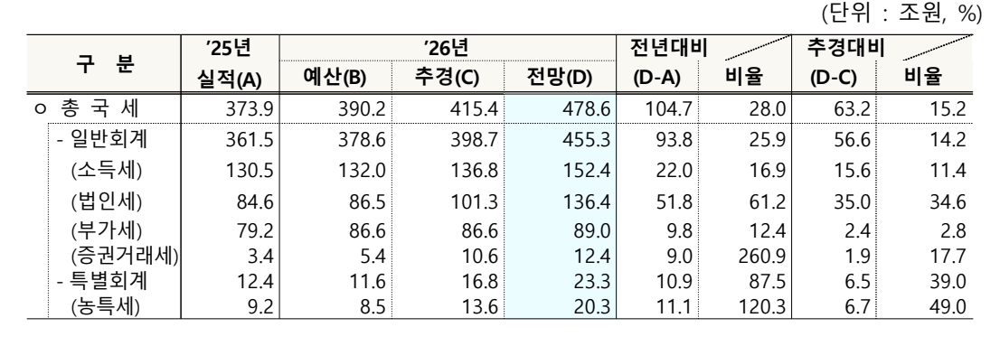

# 벤치마크·구현 상세

README 요약 뒤의 전체 표·조건·시험했지만 뺀 것·구현·한계. 날짜순 측정 기록과 명령은 [VERIFICATION.md](VERIFICATION.md).
벤치 스크립트·데이터는 저장소 밖 `test-field/parser-bench/document_parser_cmp/`(README 에 색인). README 그림
(배너·벤치 카드·예시)은 같은 폴더 `readme_visuals/build.py` 가 HTML 로 그려 크롬 헤드리스로 찍는다(수치는 이 문서의 표와 같다).

## 원칙

- 같은 PC(Windows, RTX 4070 SUPER)에서 각 파서의 기본 설정으로 잰다. 다른 설정을 쓰면 표에 적는다.
- **출력은 LLM 이 읽는다.** 표 시험은 olmOCR 공식 TableTest 가 통과하거나, 띄어쓰기·점 줄·각주 표시·한 칸 두 줄이 두 행으로
  나뉜 것처럼 뜻이 같은 차이만 있으면 정답(`meaning_tests.py`). 값이 다른 행·열에 붙으면 오답.
- 튜닝용과 평가용을 나눈다. 한국 PDF 표는 튜닝용 37건 · real4 15건(분석에 씀) · real5 14건(판정용, 개발에 안 씀).
  ICDAR 은 dev/holdout 을 나눴고, DP-Bench 는 공개 비교용이라 200쪽 모두 튜닝에 썼다(평가용이 아니다).
- **굵은 글씨**는 열마다 가장 좋은 값.

## 한국 공공 문서 PDF 표 (2026-10-22)

정부 보도자료·법령 서식 PDF 와 짝인 **원본 HWPX 표**에서 표 시험을 자동으로 만들었다(표마다 숫자가 든 유일한 칸 최대 8개의
바로 위·왼쪽 칸). 원본에 선·배경이 없어 PDF 에서는 그냥 글로 보이는 배치용 표는 묻지 않는다.

| 파서 | 표 시험<br>튜닝용 37건 | 표 시험<br>real4 15건 | 표 시험<br>real5 14건 | 낱말 재현율<br>튜닝용 / real4 / real5 |
|---|---:|---:|---:|---|
| **process-gpt-document-parser** | **98.3%** | **96.6%** | **95.6%** | **100.0** / 99.6 / **99.2** |
| kordoc 4.22.13 | 87.4% | 95.6% | 90.9% | 99.9 / **99.8** / **99.2** |
| docling 2.x (HTML 표) | 88.8% | 75.1% | 88.3% | 99.1 / 98.8 / 98.6 |
| pymupdf4llm 1.28 | 86.4% | 79.3% | 70.2% | 98.5 / 99.7 / 98.2 |
| markitdown 0.1.8 | 38.2% | 26.3% | 32.1% | 99.5 / 99.6 / 98.7 |
| opendataloader-pdf 2.5.13 (하이브리드) | 18.5% | 15.6% | 56.8% | 53.8 / 62.3 / 89.9 |
| opendataloader-pdf 2.5.13 | 14.6% | 11.9% | 47.5% | 54.4 / 63.7 / 91.7 |

- 문항 수: 튜닝용 4,659 · real4 899 · real5 1,170(배치용 표·생성기 결함 문항을 뺀 뒤).
- 우리 쪽 핵심 규칙: 한컴 PDF 의 칸 클립(`m l l l h W* n`)으로 칸 경계, 점선 이어 붙이기, 숨은 칸 경계, 하위 행 나누기,
  쪽 넘김 표 머리행 잇기. 근거는 [spec.md](spec.md) "PDF", 측정은 VERIFICATION "한국 PDF 표 개선"·"kordoc 비교".
- 명령: `run_parsers.py ko-pdf <파서>` → `ai_table/compare3.py`(의미 기준) 또는 `korean_bench.py ko-pdf`.

## 한국 공공 문서 HWP 표 (2026-10-16)

| HWP 18건 | 표 시험 | 낱말 재현율 |
|---|---:|---:|
| **process-gpt-document-parser** | **97.0%** | 100% |
| extract-hwp | 86.7% | 100% |
| pyhwp (hwp5txt) | 0% (표 없음) | 33.6% |

같은 문서의 HWP 와 HWPX 출력은 낱말 단위로 같다(`cmp_hwp.py`). HWP 3.x 는 한컴 변환본 9쌍과 맞대어 확인했다(VERIFICATION "HWP 3.x").

## 영문 정부 표 — ICDAR 2013 (2026-10-23)

ICDAR 2013 표 대회 67건(EU·US 정부 문서, 글 레이어 있는 PDF). 정답 표에서 한국 표와 같은 방식으로 만든 표 시험 1,123문항과 TEDS.
2026-10-23 부터 67건 모두 튜닝에 썼다(dev 99.0%, holdout 98.2% — holdout 도 실패를 보고 고쳤으므로 평가용이 아니다).

| 파서 | 표 시험 | TEDS | TEDS-S(구조만) |
|---|---:|---:|---:|
| **process-gpt-document-parser** | **98.5%** | **90.5%** | 91.4% |
| docling | 97.8% | 89.5% | **91.5%** |
| pymupdf4llm | 90.0% | 85.6% | 89.8% |
| opendataloader-pdf (하이브리드) | 64.1% | 72.5% | 90.2% |
| opendataloader-pdf | 52.4% | 56.1% | 56.9% |
| kordoc | 52.0% | 50.1% | 53.8% |
| markitdown | 40.2% | 33.6% | 40.7% |

## DP-Bench — Upstage 공개 벤치 200쪽 (2026-10-23)

공식 `evaluate.py`. 공식 채점은 파싱에 실패한 쪽을 평균에서 빼므로, 실패한 쪽은 빈 출력으로 넣은 값을 함께 적는다(kordoc 11쪽 실패).
**이 셋은 우리 규칙 튜닝에 썼다.** kordoc 도 README 성적으로 같은 200쪽(opendataloader-bench `pdfs/`)을 쓴다.

| 파서 | 읽기 순서 NID | 표 F1 | 표 TEDS | TEDS-S |
|---|---:|---:|---:|---:|
| **process-gpt-document-parser** | **96.1** | 97.2 | **99.2** | 99.6 |
| ↳ + 그림 VLM 콜백(gpt-6-luna) | **96.1** | **99.1** | 99.1 | **99.7** |
| kordoc (공식: 실패 11쪽 빼고) | **96.1** | 97.2 | 98.8 | 99.6 |
| kordoc (실패 쪽 빈 출력) | 90.8 | 97.2 | 98.8 | 99.6 |
| opendataloader-pdf (하이브리드) | 90.4 | 94.5 | 72.6 | 97.1 |
| docling | 86.9 | 91.5 | 95.1 | 96.5 |
| pymupdf4llm | 89.6 | 87.0 | 84.9 | 91.8 |
| opendataloader-pdf | 93.7 | 43.3 | 90.0 | 91.0 |
| markitdown | 81.6 | 0.0 | 0.0 | 0.0 |

- NID 를 kordoc 이 읽은 189쪽으로 맞추면 96.27 vs 96.07. 우리 NID 는 200쪽 평균 96.09.
- 그림 VLM 은 그림 영역 글을 figure 로 친다(정답도 그림·차트 글은 NID 에서 뺀다). 그림으로 박힌 표 2쪽(110·122)을 더 찾는다.
- 남은 실패: 197(정답 표가 한 칸짜리로 깨짐). 규칙만으로는 그림 표 2쪽을 못 읽어 F1 이 kordoc 과 같다.
- 명령: `ai_table/run_round.sh w20` → `ai_table/round_w20.log`, VLM 은 `run_parsers.py dpbench ours_vlm` → `dp_bench.py ours_vlm`.

## 문서 속 그림

2026-10-23. 목표: 문서 중간의 그림(표·글·그래프·도식 그림)을 읽었을 때, **문서 전체를 LLM 이 읽고 그 정보를 쓸 수 있게 되나**.
공개 벤치가 없어 작게, 대신 정답을 사람이 그림마다 보고 만들었다(`document_parser_cmp/vlm_ocr/bench/`, 확인 화면 포함).

- 문서 14건: 토론회·자료집 슬라이드, 산업·감염병 보고서, 판결문 2, 보도자료 HWPX 2, 표를 96dpi JPEG 그림으로 바꾼 보도자료 2,
  대국민 보고, 간담회 슬라이드, 연구 보고서(KoPub·Allganize·parser-bench 문서에서 고르고 긴 것은 쪽 발췌).
- 그림 106개 = 우리 파서가 내는 그림 블록. 정답: 읽을 것 78(그래프 27·표 20·글 14·도식 11·제목 띠 4·라벨 붙은 사진 2) /
  건너뛸 것 28(로고 13·글 레이어와 같은 글 10·장식 4·사진 1). 기준은 "이 문서에만 있는 정보인가".
- 질문 108개: 그림에만 있는 사실. 그림 밖 본문으로 풀리던 31문항은 빼거나 바꿨다(콜백 없는 판 0문항 확인).
- 채점: 파서 출력 마크다운 전체와 그 문서 질문을 gpt-6-luna 에 주고 답하게 한 뒤 정답과 스크립트로 대조(공백·쉼표·단위 정규화).
  떨어진 답만 LLM 이 같은 뜻인지 한 번 더 본다("모름"은 오답). 정답 옮김을 넣은 판은 108/108.

| 구성 | PDF 12건 (99문항) | 14건 (108문항) | 그림 처리 | 시간·비용 |
|---|---:|---:|---|---|
| **우리 + VLM**(`describe` 콜백, luna) | **94** | **103** | 그림 블록 97개 VLM(80px 미만·되풀이 제외) | 문서 14건 VLM 호출 97, ≈ $0.020 |
| 우리 + VLM(그림 블록마다 직접 호출) | 93 | 102 | 106개 전부 | 35초(병렬 8), ≈ $0.020 |
| 우리 + RapidOCR 한국어(PP-OCRv5 mobile) | 62 | 65 | 106개 전부 OCR | OCR 136초(CPU) |
| docling + EasyOCR 한국어 + 같은 VLM 그림 설명 | 54 | — | 그림으로 분류된 것 중 쪽 5% 이상 45개 | 107초(GPU), ≈ $0.007 |
| docling + EasyOCR 한국어 | 29 | — | 비트맵 영역 OCR | 94초(GPU) |
| pymupdf4llm | 17 | — | 기본 OCR(중국어·영어 모델) | 148초 |
| docling 기본 | 9 | — | 기본 OCR(라틴) | 217초(모델 적재 포함) |
| kordoc | 3 | — | 그림 무시 | 29초 |
| markitdown · opendataloader-pdf · 우리(콜백 없음) | 0 | 0 | 그림 무시 | 7~13초 |

- VLM 지시(모든 VLM 판 같음): "로고·표어·사진·장식처럼 문서 고유의 정보가 없으면 SKIP. 표는 마크다운 표로, 글은 그대로,
  그래프는 제목과 값을, 도식은 단계·관계를 목록으로. 보이는 글자·숫자만."
- 같은 VLM 인데 docling 이 40문항 낮다: 레이아웃 모델이 그림 표·글 상자를 표·글로 분류해 OCR 로 읽고, 쪽 면적 5% 미만 그림은
  설명하지 않는다. 그림 영역을 빠짐없이 VLM 에 넘기는 것이 차이다.
- OCR 모델 판은 줄 글만 나와 표 행·열과 그래프 계열 짝이 흐려진다. 숫자 849개 중 45개 빠짐, 정답에 없는 숫자 26.
  건너뛸 그림 28 중 22 에서 글을 냈다(가려내지 않는다).
- VLM 판의 남은 문제: 건너뛸 그림 28 중 18 에도 글을 냈다(로고 문구·글 레이어와 같은 띠, 517자). 틀린 문항은 값 라벨 없는
  그래프의 계열 짝짓기, 별표 표, 도식의 합계 숫자 누락.
- 명령: `vlm_ocr/bench/run_describe.py ours_describe`·`run_vlm.py`·`run_ocr.py rapidocr_ko`·`run_others.py <파서>` → `score.py <이름>`.

## 속도

- DP-Bench 200쪽을 한 프로세스로 `parse()`: 13.9초(쪽당 0.07초, CPU, 2026-10-26, v0.1.0 은 19.5초).
- 그래프가 많은 한국 보고서(국민건강영양조사 별첨 24쪽): 24.7초(v0.1.0 101.5초). 한국 PDF 37건: 150.9초(v0.1.0 350.8초).
  선·사각형은 pdfium 으로 읽고 글자는 경로 명령을 걷어 낸 스트림으로 pdfminer 가 읽는다(VERIFICATION "pdfium 엔진").
- 비교 러너의 한국 PDF 쪽당 시간(여러 파서가 같이 돌아 참고만): kordoc 0.29 · 우리 0.53 · markitdown 0.77 · opendataloader 0.84 ·
  docling 2.09(GPU) · pymupdf4llm 4.43초.

## 시험했지만 뺀 것

| 무엇 | 결과 | 기록 |
|---|---|---|
| 모델 모드: 레이아웃 모델(docling-layout-heron) + 표 구조 모델(TableFormer) 콜백 | 규칙 강화 뒤 한국 표 −1.7~+0.2%p, torch·GPU 필요. 영문 논문(olmOCR)에서는 마지막 측정(10-21)에 +26%p 였다 | VERIFICATION "AI 모드·모델 모드 뺌" |
| AI 표 모드(LLM 이 규칙 표를 검증·다시 쓰기, gpt-6-luna) | DP-Bench 표 F1 94.2→98.1, ICDAR 94.6→97.1 이지만 한국 튜닝용 98.3→97.7(맞는 표를 갈아 끼움), 쪽당 시간 1.7배 | 같은 절, "DP-Bench 표 규칙" |
| 표 찾기에 LLM 좌표만 받기 | 표는 더 찾지만 선 없는 표의 행·열을 못 나눠 구조 점수가 떨어짐 | VERIFICATION "AI 모드·모델 모드 뺌" |
| Camelot(표만 뽑는 라이브러리) 콜백 | 한국 표 효과 없음, 그냥 붙이면 2단 본문을 표로 잡음 | spec.md "결정과 근거" |
| olmOCR-Bench 성적표 | OCR·VLM 변환기용(스캔·머리말·다단 위주)이라 글 레이어 파서 성적에서 뺐다 | VERIFICATION "공개 벤치 성적표" |

## 출력 형식 (LLM 질의응답, 2026-10-16)

표 76개·질문 280개를 Qwen3.8-27B-FP8(사내에서 서빙)과 gpt-6-luna 에 물었다. 기본값인 "병합 칸 값을 덮인 칸마다 채운 마크다운"이
Qwen3.8 94.6% vs HTML 90.7%(p=0.027), luna 99.6% vs 98.6%. 첫 칸에만 두는 마크다운은 둘 다 기본보다 낫지 않았다.

## 포맷 지원 (실측: 포맷마다 같은 문서 하나를 넣어 글이 나오는지)

| 파서 | HWP | HWP 3.x | HWPX | DOC | DOCX | PDF | 라이선스 |
|---|---|---|---|---|---|---|---|
| **process-gpt-document-parser** | 지원 | 지원 | 지원 | 지원 | 지원 | 지원 | Apache-2.0 |
| kordoc | README 상 지원 | — | README 상 지원 | — | — | 지원 | MIT |
| docling | 미지원 | 미지원 | 미지원 | 미지원 | 지원 | 지원 | MIT |
| markitdown | 미지원 | 미지원 | 미지원 | 미지원 | 지원 | 지원 | MIT |
| pymupdf4llm | 글 없음 | 미지원 | 지원 | 미지원 | 지원 | 지원 | AGPL-3.0 |
| pyhwp (hwp5txt) | △ 글 일부 | 미지원 | 미지원 | 미지원 | 미지원 | 미지원 | AGPL-3.0 |
| extract-hwp | 지원 글만 | 미지원 | 지원 글만 | 미지원 | 미지원 | 미지원 | BSD-3 |

kordoc 은 PDF 만 이 벤치로 돌렸다. HWP·HWPX 는 kordoc README 기준이고 HWP 3.x·DOC·DOCX 는 확인하지 않았다(—).

## 포맷과 구현

| 포맷 | 읽는 방법 | 구현 |
|---|---|---|
| HWP 5.0 | OLE 안 DocInfo·BodyText 레코드 트리를 직접 해석. 문단·표(병합)·개요 헤딩·그림·글상자·각주. 배포용 문서(ViewText) 복호화 | 자체 구현 (한컴 공개 명세) |
| HWP 3.x (한글 97 이하) | 압축 본문의 문단 리스트를 한 번에 읽는다. 문단·표(셀 좌표로 병합 복원)·그림·글상자·각주. 글자 코드는 조합형 한글·KS X 1001 기호·한자로 바꾸고 모르는 한컴 고유 기호는 경고로 남긴다 | 자체 구현 (한컴 공개 명세) |
| HWPX | OWPML XML 을 문서 순서로 순회 | 자체 구현 (KS X 6101) |
| DOC | FIB → 피스 테이블 → 문단 속성(PAPX)으로 표 칸·행·병합·헤딩, 문자 속성(CHPX)으로 인라인 그림, 도형 앵커(PlcfSpa)·OfficeArt 로 글상자·떠 있는 그림 | 자체 구현 ([MS-DOC]·[MS-ODRAW]) |
| DOCX | WordprocessingML XML 순회. 메모 위치·헤딩 스타일 상속·병합 칸·콘텐츠 컨트롤 | 자체 구현 (ECMA-376) |
| PDF | 글자를 기록 순서대로 줄·블록으로 묶는 레이아웃 분석, 괘선·점선·칸 클립·가로선만 있는 표·선 없는 표 복원, 하위 행 나누기, 쪽 넘김 표 머리행 잇기, 반복 머리말·로고 제거, 그림 영역 병합, 스캔 쪽 판별 | 자체 구현. 글자·선 추출(pdfplumber/pdfminer.six)과 렌더(PDFium)는 공개SW |

쓰는 공개SW 와 라이선스는 [NOTICE.md](../NOTICE.md).

본 제품은 한글과컴퓨터의 한/글 문서 파일(.hwp) 공개 문서를 참고하여 개발하였습니다.

## 출력 구조

- `Document`: `format`, `blocks`, `page_sizes`(PDF), `metadata`, `warnings`. `to_markdown()`, `to_dict()`, `pages()`.
- `Block`: `kind`(paragraph·table·image), `text`, `heading_level`, `table`, `image`, `page`, `bbox`, `comments`(DOCX 메모), `ocr`.
- `Table`: `cells`(행·열·행 병합·열 병합), `grid()`, `to_markdown()`, `to_html()`.
- `Image`: 원본 bytes·mime, `description`.

표 출력 형식은 `doc.to_markdown(table_format=...)` 로 고른다: `markdown`(기본, 병합 칸 값을 덮인 칸마다),
`markdown-first`(첫 칸에만), `html`(rowspan·colspan).

## 모델 콜백 (그림 설명·OCR)

라이브러리는 모델을 직접 부르지 않는다. 호출자가 함수를 넘긴다.

```python
doc = parse("보고서.pdf",
            describe=lambda data, mime: my_vlm.describe(data, mime),   # 그림 → 글(설명 또는 그림 속 정보)
            ocr=lambda png: my_vlm.transcribe(png),                    # 스캔 쪽 → 글
            max_workers=4)
```

- 같은 그림(바이트 동일)은 한 번만 부르고, 설명은 처음 나온 자리에만 단다. 짧은 변 80px 미만은 부르지 않는다.
- PDF 는 그림 조각(XObject)마다가 아니라 붙어 있는 그림을 한 영역으로 묶어 영역마다 한 번 부른다.
  여러 쪽 같은 자리에 되풀이되는 로고·워터마크는 부르지 않는다. 쪽의 절반 이상을 덮는 영역은 `ocr` 로 받아쓴다.
- 글 레이어가 없거나 깨진(글꼴 대응표 없는) PDF 쪽은 쪽 전체를 렌더해 `ocr` 에 넘긴다.
- `describe` 가 빈 글을 돌려주면 그 그림은 출력에 남지 않는다(로고 등 건너뛰기).

## 실제 문서에서

정부 보도자료 PDF(「26년 국세수입 재추계」, 2026-09-29 배포)의 표. 바깥 세로 테두리가 없고, 행 이름 8개와 값이
한 칸에 몰려 있는(행 사이 가로선이 없는) 전형적인 공공 문서 표다.



이 라이브러리의 출력 (2026-10-16, 그대로 붙임):

| 구 분 | ’25년 / 실적(A) | ’26년 | ’26년 | ’26년 | 전년대비 | 전년대비 |   | 추경대비 | 추경대비 |   |
| --- | --- | --- | --- | --- | --- | --- | --- | --- | --- | --- |
| 구 분 | ’25년 / 실적(A) | 예산(B) | 추경(C) | 전망(D) | (D-A) | 비율 | 비율 | (D-C) | 비율 | 비율 |
| ㅇ 총 국 세 | 373.9 | 390.2 | 415.4 | 478.6 | 104.7 | 28.0 | 28.0 | 63.2 | 15.2 | 15.2 |
| - 일반회계 | 361.5 | 378.6 | 398.7 | 455.3 | 93.8 | 25.9 | 25.9 | 56.6 | 14.2 | 14.2 |
| (소득세) | 130.5 | 132.0 | 136.8 | 152.4 | 22.0 | 16.9 | 16.9 | 15.6 | 11.4 | 11.4 |
| (법인세) | 84.6 | 86.5 | 101.3 | 136.4 | 51.8 | 61.2 | 61.2 | 35.0 | 34.6 | 34.6 |
| (부가세) | 79.2 | 86.6 | 86.6 | 89.0 | 9.8 | 12.4 | 12.4 | 2.4 | 2.8 | 2.8 |
| (증권거래세) | 3.4 | 5.4 | 10.6 | 12.4 | 9.0 | 260.9 | 260.9 | 1.9 | 17.7 | 17.7 |
| - 특별회계 | 12.4 | 11.6 | 16.8 | 23.3 | 10.9 | 87.5 | 87.5 | 6.5 | 39.0 | 39.0 |
| (농특세) | 9.2 | 8.5 | 13.6 | 20.3 | 11.1 | 120.3 | 120.3 | 6.7 | 49.0 | 49.0 |

## 알려진 한계

- Word 6/95 이전 DOC 은 지원하지 않는다. 암호 문서는 `EncryptedDocumentError`.
- HWP 3.x 의 한컴 고유 기호 일부(구분선 글자 등)는 U+FFFD 로 두고 `warnings` 에 남긴다. 한컴 변환본도 이 글자들을 사용자 정의 영역 글자로 낸다.
- 머리말·꼬리말은 본문에서 뺀다(HWP·HWPX·DOC·DOCX). PDF 는 여러 쪽에 되풀이되는 가장자리 글만 뺀다(한 쪽짜리 PDF 는 못 뺀다).
- 수식은 글로 옮기지 않는다.
- 영문 논문식 PDF(선이 하나도 없는 표·다단 머리말)는 모델을 쓰는 파서보다 약하다(olmOCR 기준, 10-21).
- 문단 사이 간격이 줄 간격과 같은 PDF 는 문단이 나뉘지 않는다(글은 온전하다).
- 그림 콜백은 그림 단위라, 슬라이드 배경 그림처럼 글 레이어와 같은 글이 그림에 섞이면 VLM 이 그 글을 한 번 더 옮긴다.
- 기본 표 형식은 큰 병합 칸이 많은 서식에서 글을 크게 부풀린다. [VERIFICATION.md](VERIFICATION.md) 참고.
